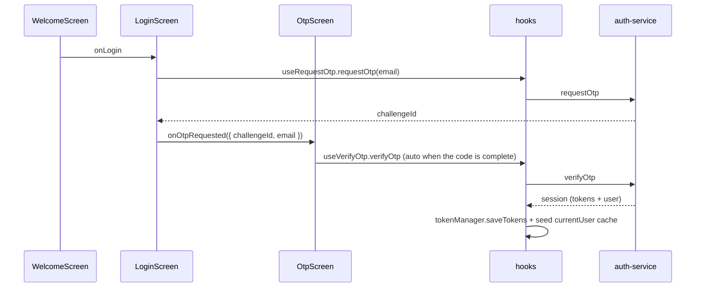

# auth

Passwordless email-OTP sign-in (ADR-0007), registration, session restore, logout and
account deletion. The only feature that talks to the backend today.

## Layers

```text
Screen -> feature hook -> auth-service -> shared apiRequest -> backend
```

| Layer   | Files                                                                                       |
| ------- | ------------------------------------------------------------------------------------------- |
| Screens | `WelcomeScreen`, `LoginScreen`, `OtpScreen`, `RegisterScreen`                               |
| Hooks   | `useRequestOtp`, `useVerifyOtp`, `useLogin`, `useRegister`, `useLogout`, `useDeleteAccount` |
| Session | `useAuthSession` (startup readiness), `useCurrentUser`, `useAuthTransportBridge`            |
| Service | `services/auth-service.ts` (endpoints), `auth-api.types.ts` (DTO parsing to feature models) |

## Sign-in flow



After the cache is seeded, `useAuthSession` reports `authenticated` and the app shell
leaves the auth stack.

## Rules worth knowing

- Tokens are stored only through `tokenManager` (keychain), never in Query, params or logs.
- `useLogout` and `useDeleteAccount` clear local tokens and the auth cache in
  `onSettled`, even when the server call fails.
- Account deletion and the consent checkbox follow Luật 91/2025 and NĐ 356/2025
  (consent is never pre-checked).
- `useAuthSession` exposes `isInitializing` so the splash waits for real readiness
  (ADR-0009); do not add fixed delays.
