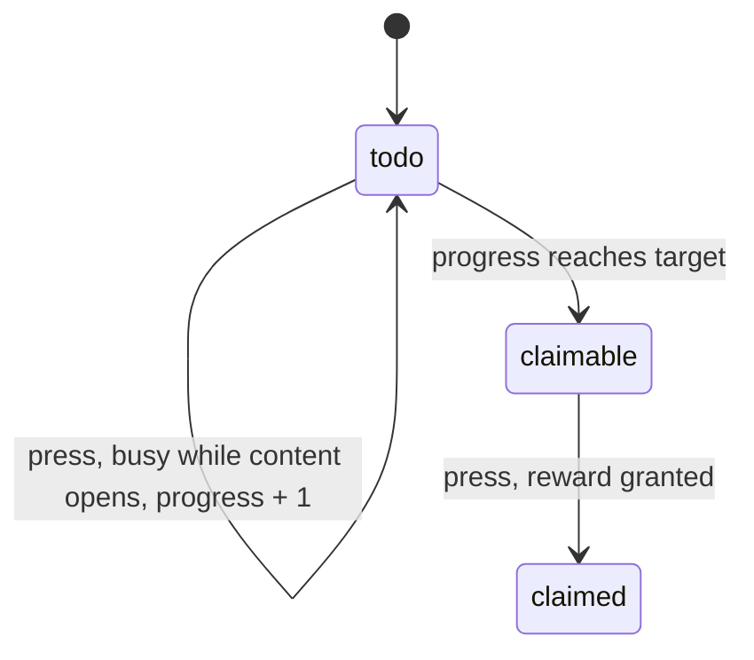

# missions

Daily and weekly missions, coins and the streak reward.

- `useMissions` is the state machine; `MissionScreen` only lays out and animates.
- Wallet: when the app passes `coins` and `onEarn`, the app shell owns the balance;
  otherwise the hook keeps a local one. Rewards always go out through `onEarn`.
- `claimStreak` grants the streak reward for today.
- **Mock seam (ADR-0019):** progress is simulated, there is no server yet.
