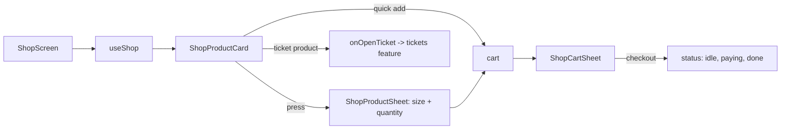

# shop

Browse merchandise, add to cart and check out.

- `useShop` owns category, search, cart, product sheet, checkout status and toast.
- Ticket products do not open the sheet; they call `onOpenTicket(zone)` and the app
  shell navigates to the tickets feature (features never import each other).
- Totals come from `data/shop-selectors.ts`.
- **Mock seam (ADR-0019):** checkout is a timer, no payment is taken.
