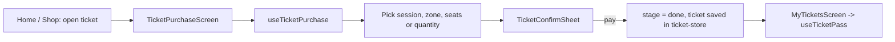

# tickets

Buy tickets for an event and show the purchased pass.

- Entry: `TicketPurchaseScreen` (optionally with `initialZone`) and `MyTicketsScreen`.
- `useTicketPurchase` owns the stage (`pick`, confirm, `done`), selection and payment method.
- `data/ticket-store.ts` is an in-memory store for the ticket bought in this session, so
  the purchase and "my ticket" screens share one source.
- **Mock seam (ADR-0019):** `pay` is a timer, there is no real transaction. When a
  payment provider is added, put the call in a feature service and keep the screens.
- E-commerce rules (Luật 122/2025): show price, order summary and cancellation
  information before payment.
